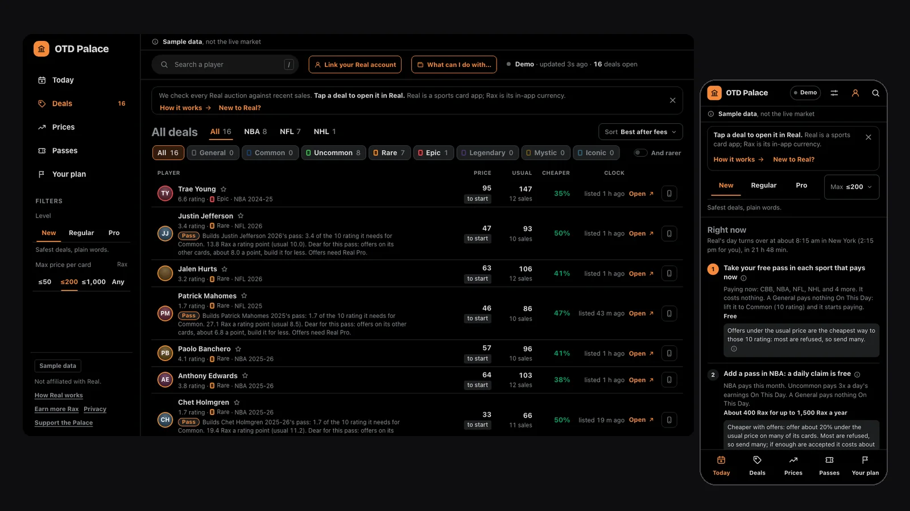
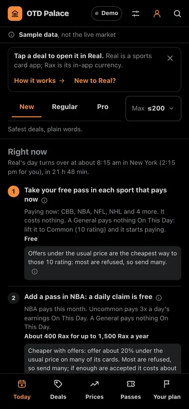
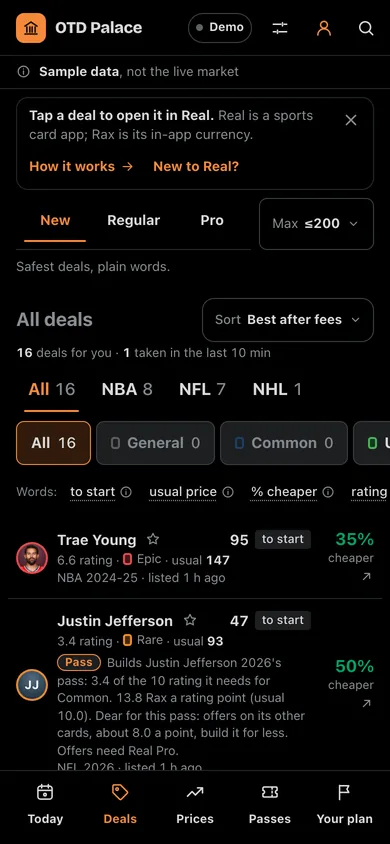
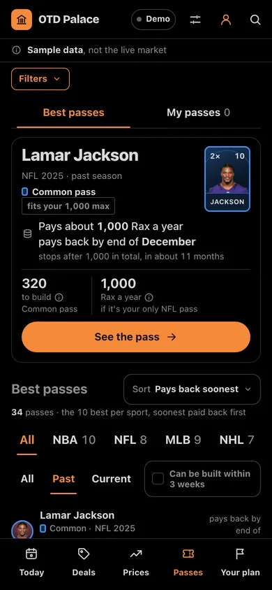
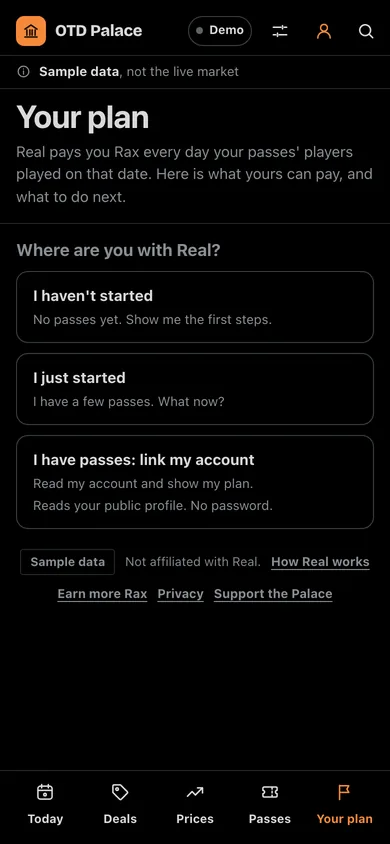
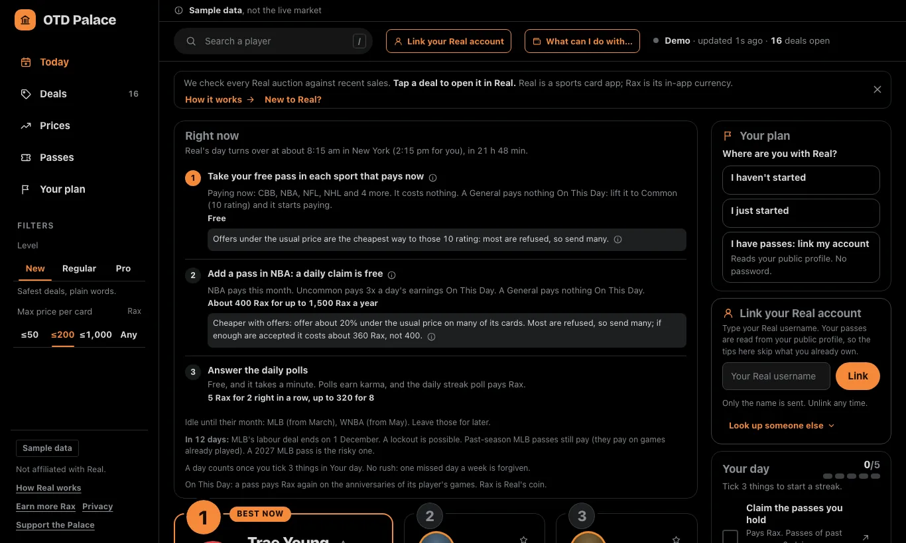
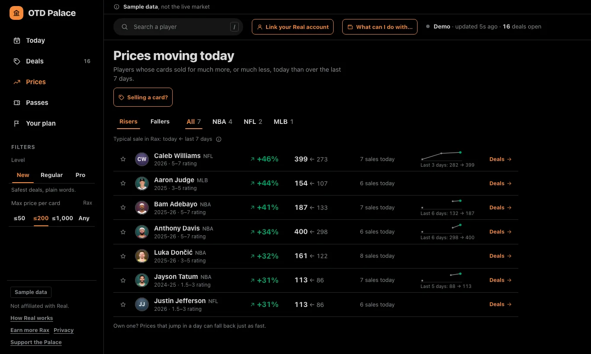
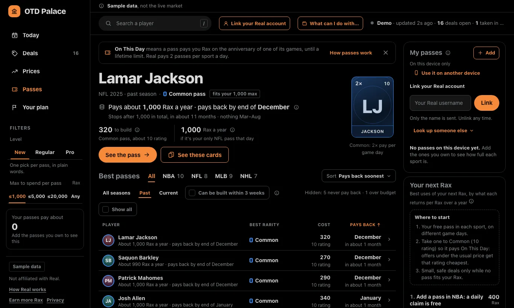
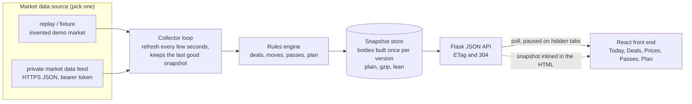

<div align="center">

# OTD Palace

**A free market advisor for players of the Real sports card app.**<br>
It spots the auctions priced well below what the same card really sold for, the *On This Day* passes that pay back fastest, and the players whose prices are moving.

[](https://otdpalace.com)




</div>

> OTD Palace is an independent project and is not affiliated with Real. This repository runs on an **invented demo market**, so everything works offline with no account and no outside service.

## What it does

People open the site on their phone between two actions in the Real app, so every screen is built to be read in seconds and to hand the player straight back to the app.

| Screen | What it shows |
| --- | --- |
| **Today** | A short "right now" checklist: the free pass to take, the next pass worth adding, the daily polls, and what to leave for later. A day counter and a ranked top three of deals. |
| **Deals** | Every open auction compared with the price the card usually sells for (from real recent sales, with the sample size shown), sorted by what is left after fees, filterable by level, sport, rarity and budget. Hurt players are tagged. |
| **Prices** | Risers and fallers: players whose cards sold for much more or much less today than over the last seven days, with a small price curve. |
| **Passes** | *On This Day* passes ranked by how soon they pay back, with cost, yearly yield and the cheapest way to build the rating. A "My passes" panel and a planner for what to spend next. |
| **Your plan** | Pick where you are with Real (not started, just started, or link a public profile) and get an ordered plan. Only the username is sent; no password is ever asked for. |

Around that core: shareable deal pages with a drawn SVG card, optional Web Push alerts, an optional Discord sign-in for a member tier, a privacy notice generated from the retention constants in the code, and a small admin panel.

<table>
  <tr>
    <td></td>
    <td></td>
    <td></td>
    <td></td>
  </tr>
</table>

<details>
<summary>More desktop screens</summary>





</details>

The screenshots were taken from the demo mode described below. The player photos come from public sources at run time and are not stored in the repository.

## Tech stack

- **Front end:** React 19, TypeScript, Vite, hand-written CSS with custom-property tokens (no CSS framework), Vitest and Testing Library.
- **Back end:** Python 3.13, Flask served by Waitress, Pillow for the drawn share assets and photo handling, `pywebpush` for alerts.
- **Quality:** pytest, Playwright browser checks at phone and desktop sizes, a multi-stage Dockerfile with hash-pinned Python requirements.

## Architecture



The server runs one collector thread. Each round it asks a source for the market, builds a snapshot with the rules engine, and publishes it to the store. If a round fails, the previous snapshot is kept and ages visibly: after a threshold the page says the data is paused, so an old market is never shown as live.

Two interchangeable sources feed the collector. The **demo sources** (`replay`, which keeps the invented market moving, and `fixture`, which is static) ship with the code. The **feed source** reads one JSON document from a private market data feed over HTTPS, and is the only part that depends on infrastructure outside this repository (see [Live feed source](#live-feed-source)).

## Engineering highlights

Everything below can be checked in the code.

- **Response bodies are built once per snapshot version.** `advisor/store.py` keeps, per version, the plain, gzip and "lean" (without the slow-changing pass data) bodies and their ETags; requests are answered from memory and an unchanged snapshot is a `304` with no body. `advisor/web.py` does the same for the built assets (gzip, and brotli files written by the build in `frontend/src/build/brotli.ts`).
- **The first paint needs no request.** The snapshot is inlined in the served HTML, then the client polls for changes.
- **Polling that behaves.** `frontend/src/data/useSnapshot.ts` stops polling and the age ticker while the tab is hidden, re-checks and polls as soon as it is visible again, polls four times less often on a phone in data- or battery-saving mode, sends the held pass version so the server can leave unchanged data out, and aborts slow requests.
- **Stale data is never shown as live.** Freshness is exposed on `/healthz` (only `ok`, `age_s` and `version`), and the UI switches to a paused state when a refresh is overdue.
- **Strict handling of the outside world.** The feed reader accepts HTTPS only, no redirect, no proxy, a hard timeout and size limit (also on the unzipped body), and its errors never contain the token or address. A strict Content-Security-Policy is set by the server.
- **Guard tests for CSS and touch targets.** `frontend/src/styles/taps.test.ts` and `styles.test.ts` read the stylesheets as text and fail if a small control loses its 44 px tap area, if animations lose their `prefers-reduced-motion` fallback, and similar regressions.
- **Parity tests between the two halves.** Rules that exist in both Python and TypeScript (pass planner, season events, copy that quotes constants) are checked against shared golden vectors in `tests/fixtures/`, so the browser and the server cannot drift apart.
- **Privacy by construction.** No password or email is ever asked for, no third-party analytics; the privacy notice reads its retention periods from the same constants the code enforces, and a test checks it.

## Run it locally (demo mode)

Requirements: Python 3.13 with [uv](https://docs.astral.sh/uv/), and Node 22 or newer.

```sh
uv sync
npm --prefix frontend ci
npm --prefix frontend run build     # writes the build into advisor/static/
uv run python server.py             # ADVISOR_SOURCE defaults to the replay demo
```

Open <http://localhost:8795>. `curl http://localhost:8795/healthz` reports whether the data is fresh.

Useful settings (environment variables, all optional): `PORT`, `ADVISOR_SOURCE` (`replay`, `fixture` or `feed`), `ADVISOR_INTERVAL_S`, `ADVISOR_DATA_DIR` (where counters and caches are written; keep it out of the repository), `ADVISOR_COMMUNITY_URL`.

For front end development, `npm --prefix frontend run dev` starts Vite.

## Run the tests

```sh
npm --prefix frontend ci && npm --prefix frontend test -- --run     # front end (Vitest)
npm --prefix frontend run typecheck                                 # TypeScript
uv run pytest -q --ignore=tests/e2e                                 # server (pytest)
```

The browser checks in `tests/e2e/` need the front end built and Chromium (`uv run playwright install chromium`); without Chromium they are skipped.

## Live feed source

`ADVISOR_SOURCE=feed` reads a private JSON document (`ADVISOR_FEED_URL`, `ADVISOR_FEED_TOKEN`) with the same shape as the demo fixture in `advisor/fixtures/demo_raw.json`, plus a version, a generation time and a coverage block. The producer of that document is not part of this repository and is not needed to run or test anything here: the reader (`advisor/sources/feed.py`) is exercised in `tests/test_feed_source.py` against fake documents.

## Project structure

```
advisor/             Python package: collector, rules engine, snapshot store, web app
  sources/           demo (replay, fixture) and feed market sources
  fixtures/          the invented demo market (demo_raw.json)
frontend/            React + TypeScript + Vite single-page app
  src/views/         Today, Deals, Prices, Passes, Your plan, admin
  src/data/          snapshot polling and local state
  src/styles/        tokens and CSS, with guard tests
scripts/             fixture and icon generators, local preview helpers
tests/               pytest suite, golden vectors, Playwright browser checks
server.py            entry point: collector thread plus web server
Dockerfile           multi-stage production image
```

Optional Discord integration (sign-in, slash commands, posts) lives in `advisor/discord_*.py`; it is off unless configured and is exercised in tests with fake Discord calls.

## Links

- Live site: <https://otdpalace.com>
